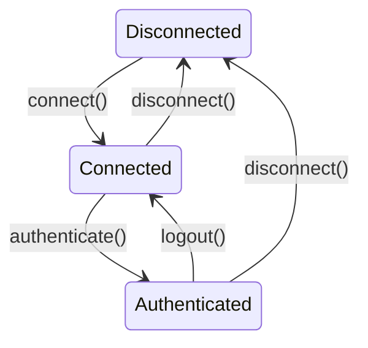

+++
title = "Designing Bulletproof APIs with Rust"
date = 2026-10-11
description = "Using Rust's type system to design APIs that prevent invalid states."
+++

## Story Time

The API is the first contact point any developer has when he or she interacts with either a new
library or a new language. This interface dictates how the user will utilize the tools provided by
the authors. Utilities such as helper functions, interfaces, structures are provided to decrease the
total boilerplate that has to be written.

Since the dawn of programming, developers have been trying to perfect the design of APIs that are
user friendly, extensible and self-documenting. These traits are more or less relevant depending on
the programming language they rely upon because each one has different quirks in terms of syntax, if
it is statically or dynamically typed, if it has a garbage collector or not or how strong the type
system is.

In this article we will take a deep dive into Rust and how its type system provides great building
blocks for library authors to come up with bulletproof APIs. But what makes an API bulletproof you
might ask. During my career as a software engineer I have learned that when working with a new API
there were some prerequisites to be done. Reading documentation, diving into the source code,
reading blog posts, watching videos, experimenting. These all seem pretty generic steps everyone
takes and I agree. But the most frustrating part of playing around with a new library is assuming
that I understood what was going on just to run the code and then have a runtime error because of a
wrong data type, variable length, function call ordering etc. These trial and error tests kept
happening until I found the correct formula for the expected outcome. And it was frustrating and
time consuming.

Why can't the API guide me through the nitty gritty details on how the pieces fit together? I
started to research this. The conclusion I have found that it is not as easy to be done especially
in dynamically typed languages. Thankfully Rust isn't one of them. Another big factor is the
capabilities of the type system. And thankfully, Rust has a pretty good one.

## How

As a general rule of thumb is that the type system is there to make invalid state
**unrepresentable**. Each procedure, program, high or low level system is a continuous transition
between states. You can think of states as different checkpoints of your business logic during the
flow of data.

## The API

### Context

The scope of our API is pretty small. We have a web service that allows users from all over the
world to utilize its features. We have to create a Rust client API in which the users will interact
with the said service. This is only demo code, it is far too simple for a production environment
(plus we don't even have a web service for the users to connect to or a name for it).

### The Building Blocks

The following sections are an introduction about the building blocks we are going to use to define
our API. If you have experience with Rust and its type system I advise you skip those.

#### Types

To represent these states you can use both the product and sum types provided by Rust. They might
sound complex but it is just the mathematical naming that was imported from this field. Product
types are `struct`s because the number of possible variants is the **product** of the inner types.

```rust
struct User {
    id: u32,
    active: bool,
}
```

The total number of possible `User`s is the number of `u32` values times the number of `bool`
values.

The sum types are the ones that have multiple variants and can represent only one variant at a time.
The best example of sum types are enums.

```rust
enum OrderStatus {
    Confirmed,
    InDelivery,
    Delivered
}
```

Rust is famous because of the emphasis put on `Result<T, E>` or `Option<T>`. These enums will help a
lot when we will define our API. Ignore the "things" inside the angle brackets, this will make much
more sense moving forward.

### Defining the Client and its States

Our users will have the possibility to connect to our service, authenticate and disconnect from it.
If you think about it all of these actions can be represented as separate states.

```rust
struct Disconnected;
struct Connected;
struct Authenticated {
    token: Token,
}
```

Now we have to define the client itself. This means another structure. But wait, we already have
three different states of the client, how do we combine all of them? One guess might be that the
client structure will contain a field `state` as an enum that is modified whenever the user
interacts with the service. This implies that the state has to be checked at runtime. Instead we
will take advantage of **generic type parameters**.

```rust
struct Client<State> {
    state: State,
}
```

Do not get confused by the name of the generic type parameter `State`. We could have named it `T`
for example. In this context it doesn't matter but I chose `State` for expressivity.

### Implementing the State Transitions

With the states already defined we can also see what are the main methods for the client. The
possible state transitions methods are: `connect()`, `authenticate()`, `logout()` and `disconnect()`.
As seen in the diagram below it creates a relationship between the states.



To have a clear separation of these methods across the states Rust's type system comes in handy once
again! Since the `Client` struct has a generic type parameter we can create different
implementations based on each state.

```rust
impl Client<Disconnected> {}
impl Client<Connected> {}
impl Client<Authenticated> {}
```

This means that the methods defined in each state are invisible from the other ones. With this tool
we can provide the users with only the allowed actions they can take in each state.

#### Disconnected

```rust
impl Client<Disconnected> {
    fn new() -> Self { ... }
    fn connect(self) -> Client<Connected> { ... }
}
```

The `new()` function creates a new instance of the `Client` struct. The `Self` return parameter
represents the implementing type.

The `connect()` method is the one that makes the state transition. It returns the next logical state
after the client connects to our service (`Client<Connected>`). As you probably saw, it also has a
parameter `self` which takes **ownership** of the object instance thus invalidating the
`Disconnected` state.

In Rust the code blocks declared in `impl` blocks can be either an associated function (which take
no `self` argument) or methods.

##### Short Intro to Self Parameters

**TLDR**: methods can have the `self` parameter as: `self`, `&self`, `&mut self`.

- `self` means that the function will take **ownership** of the object.
- `&self` means that the function uses a reference of the structure.
- `&mut self` means that the function uses a mutable reference of the structure.

#### Connected

```rust
impl Client<Connected> {
    fn authenticate(self, token: Token) -> Client<Authenticated> { ... }
}
```

What's left for the user to do after connecting to our service is to authenticate. The method
requires a Token structure that looks like this.

```rust
struct Token(String);
```

##### Newtype

This pattern is called `newtype`. Using the definition stated in the
[Rust by Example Book](https://doc.rust-lang.org/rust-by-example/generics/new_types.html) they
provide compile time guarantees so the right type of value is provided for the context in need. Our
use here is to be sure that the token provided has the required format: non-empty and its length is
not longer than 64 characters (completely arbitrary).

```rust
const MAX_TOKEN_LENGTH: usize = 64;
#[derive(Debug)]
struct TokenParseError(String);

impl TryFrom<&str> for Token {
    type Error = TokenParseError;

    fn try_from(raw: &str) -> Result<Self, Self::Error> {
        if raw.is_empty() || raw.len() > MAX_TOKEN_LENGTH {
            return Err(TokenParseError("Invalid raw token".to_string()));
        }

        Ok(Token(raw.to_owned()))
    }
}
```

There's a lot happening in this code snippet. We declared a constant `MAX_TOKEN_LENGTH` instead of
having a magic number scattered around the code. We created yet another `newtype` as the
`TokenParseError` which is a string value wrapped as the newtype.

The `impl` block is the most interesting one. It is used to implement a trait for our `Token` type!
`TryFrom` is a trait from the
[Rust Standard Library](https://doc.rust-lang.org/std/convert/trait.TryFrom.html) that allows
developers to create conversion logic between types. In our case we parse from the `&str`
([string slice](https://doc.rust-lang.org/book/ch04-03-slices.html)) to our needed `Token` newtype.

`type Error` is the
[associated type](https://doc.rust-lang.org/rust-by-example/generics/assoc_items/types.html) within
the `TryFrom` trait. The thought process is pretty clear. Because we are disciplined and down to
earth developers we know that something might go wrong with our conversion. With the associated type
the standard library trait forces us to choose what error type will be returned when the conversion
goes wrong. We chose our custom `TokenParseError` which is a `newtype`.

The `try_from` method takes a string slice and returns a `Result`. This is our first exposure to
this enum and we should make it count.

##### Result<T, E>

The definition is [`Result<T, E>`](https://doc.rust-lang.org/std/result/enum.Result.html). It states
that the function returning this type can have two variants: a happy case in which the `T` is
returned wrapped in the `Ok` enum variant or an error case in which the `E` type (in most cases its
an `Error` type) which is wrapped in the `Err` enum variant.

#### Authenticated

```rust
impl Client<Authenticated> {
    fn perform_request(&self) { ... }
    fn update_token(&mut self, new_token: Token) -> Result<(), ClientError> { ... }
    fn logout(self) -> Client<Connected> { ... }
}
```

From this point on the user is free to communicate with our service with the methods provided by the
`Authenticated` state. These are just examples and not relevant to the scope of this tutorial.

#### Representing Runtime Failure

But since we just learned about the `Result` type we can start utilizing this pattern in the
previous code blocks. This will help our end users understand that there might be errors and it is
up to them to handle them accordingly.

```diff
- fn connect(self) -> Client<Connected>
+ fn connect(self) -> Result<Client<Connected>, ClientError>

- fn authenticate(self, token: Token) -> Client<Authenticated>
+ fn authenticate(self, token: Token) -> Result<Client<Authenticated>, ClientError>
```

#### Traits

Even though Rust is not an object-oriented language it has the notion of interfaces which are called
**traits**. They can be used to make generic functions, states and even variables.

```rust
trait AccountInfo {
    fn get_info(&self) -> String {...}
}

struct User;
struct Admin;

impl AccountInfo for User {}
impl AccountInfo for Admin {}
```

In the example above the `AccountInfo` trait provides a default implementation for `get_info`. Instead
of writing the method twice, both `User` and `Admin` get it simply by implementing the trait. This
is a really short introduction to traits which are a core feature of Rust. If you need more context
and examples I advice you take a look at the
[Official Rust Trait Documentation](https://doc.rust-lang.org/book/ch10-02-traits.html#implementing-a-trait-on-a-type)
from the [Rust Book](https://doc.rust-lang.org/book/title-page.html).

#### Using Traits to Create Combined States

There might be scenarios where we would want to implement a method for more than one state. The
easiest way to do it is to create a common trait for all the states we want to target. A good
example is `disconnect()`: as the diagram shows, it should be available both in the `Connected` and
in the `Authenticated` state, but not in the `Disconnected` one. Let's create this functionality only
when the state makes sense.

```rust
trait ConnectedState {}

impl ConnectedState for Connected {}
impl ConnectedState for Authenticated {}

impl<State: ConnectedState> Client<State> {
    fn disconnect(self) -> Client<Disconnected> { ... }
}
```

The `ConnectedState` trait represents that the client is **at least** connected to our service. This
means that in both the `Connected` or `Authenticated` state the user can call this method to close
the connection to the service. Traits can have associated types and methods but in this case it is
not necessary. There are a lot of traits that fit this description in the standard library, they are
called **marker traits**.

## Connecting The Pieces

By this section the most crucial parts of our API are finished. In order to test everything we
should also call the methods. The easiest way is to have all the code in one binary file and call
everything directly in the `main()` function.

```rust
fn main() {
    let new_client = Client::new();
    let connected_client = new_client.connect().unwrap();

    let token = Token::try_from("auth-token").unwrap();
    let mut auth_client = connected_client.authenticate(token).unwrap();

    auth_client.perform_request();
    let token = Token::try_from("auth-token").unwrap();
    auth_client.update_token(token).unwrap();

    let unauthed_client = auth_client.logout();
    let _disconnected_client = unauthed_client.disconnect();
}
```

[`unwrap()`](https://doc.rust-lang.org/rust-by-example/error/option_unwrap.html) is a placeholder for the error handling that the user has to do. In a production
environment `unwrap()` will abort the execution of the program so it is not advised unless the code
**has** to be stopped. As you can see the state transition is visible even from the method calls. To
test if the compile time checks work try moving the code around to see the magic.

I will also include in the source code repository a binary file that represents the same API but
with more focus on the runtime aspect. The errors are printed only when you run it.

The type system does not replace testing, but it can eliminate entire classes of invalid API usage
before the program is ever run. In our example, an incorrect state transition order is rejected
directly by the compiler.

## Closing Thoughts

This concludes the article and the interesting topic I wanted to present. I hope your curiosity has
been sparked as much as mine was when I saw how much freedom I have to represent my programs. Feel
free to start tinkering and experimenting with your already existing code or maybe think differently
when you are designing new features or refactors.

## References

[Parse Don't Validate by Alexis King](https://lexi-lambda.github.io/blog/2019/11/05/parse-don-t-validate/)

[Rust for Rustaceans by Jon Gjengset](https://nostarch.com/rust-rustaceans)

[Rust Typestate by Cliffle](https://cliffle.com/blog/rust-typestate)

[Type Driven Development by Mark Seemann](https://blog.ploeh.dk/2015/08/10/type-driven-development/)

[A Hammer You Can Only Hold By The Handle by Andrea Lattuada](https://blog.systems.ethz.ch/blog/2018/a-hammer-you-can-only-hold-by-the-handle.html)

[Type-Driven API Design in Rust by Will Crichton](https://www.youtube.com/watch?v=bnnacleqg6k)
